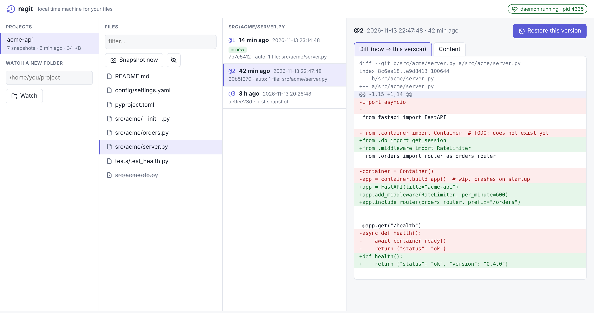
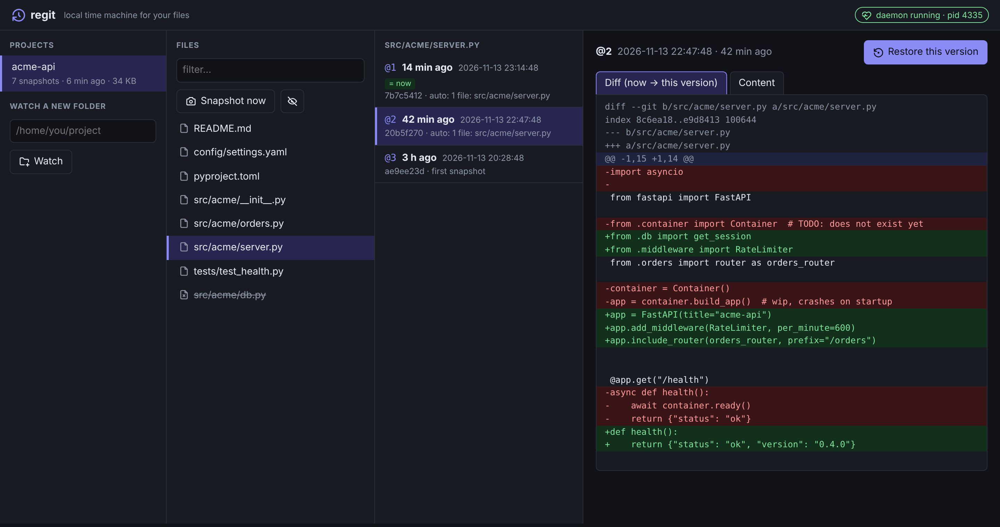
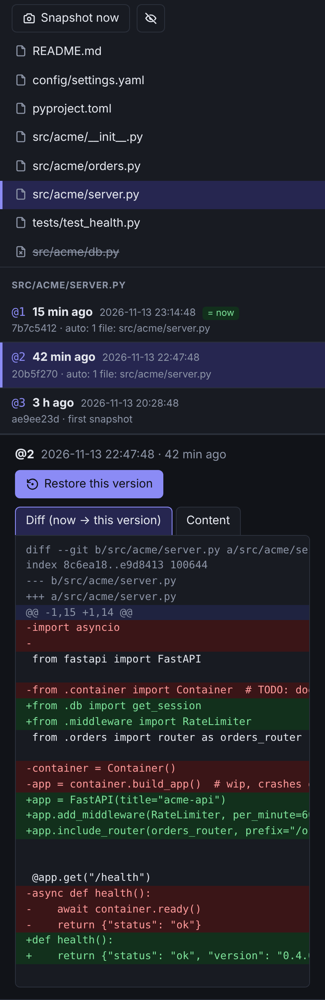
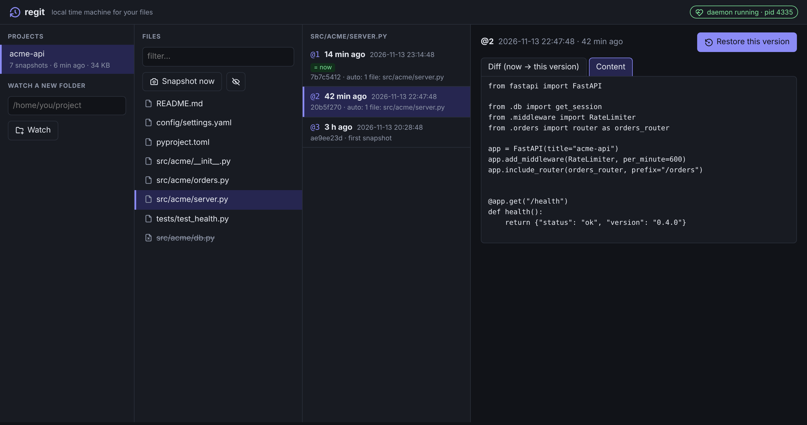

<div align="center">

# ⏪ regit

**A local time machine for your files. No commits required.**

regit quietly snapshots the folders you're working in every couple of minutes into a hidden git repo that lives *outside* your project.
When you break something badly, roll one file back to how it looked 14 minutes ago. Your real git history stays untouched.


[](LICENSE)



</div>

---

## Why

You're hacking on something big. It doesn't work yet, so you haven't committed. Then you
break it so thoroughly that `Ctrl+Z` can't reach back far enough, and `git checkout` would
throw away three hours of work.

regit fills the gap between your editor's undo and your git commits:

| | editor undo | `git commit` | **regit** |
|---|:---:|:---:|:---:|
| Survives closing the editor | ❌ | ✅ | ✅ |
| Works without you doing anything | ✅ | ❌ | ✅ |
| Per-file rollback to *"14 minutes ago"* | ❌ | ⚠️ | ✅ |
| Keeps your history clean | ✅ | ❌ | ✅ |
| Works in folders that aren't repos (`~/.config`, dotfiles…) | ✅ | ❌ | ✅ |

## Features

- **Silent auto-snapshots.** A tiny daemon takes a snapshot every 2 minutes (configurable), and only when something actually changed.
- **Never touches your repo.** Your `.git`, index and staging area stay exactly as they were. Snapshots go to `~/.local/share/regit/`.
- **Time-based restore.** `--at 14m`, `--at 2h30m`, `--at 14:30`, `--at '2026-11-13 14:30'`, `--at @3` or a hash.
- **Undo the undo.** Every restore snapshots the current state first, so you can always go back.
- **CLI and GUI.** Use the terminal, or run `regit gui` for a clickable diff viewer in your browser.
- **Cheap on disk.** git deduplicates and compresses. Snapshots older than 14 days are pruned automatically.
- **Respects your ignores.** It follows `.gitignore`, has sensible defaults (`node_modules`, `.venv`, `dist`, `target`…), and you can add more in `.regitignore`.
- **Zero dependencies.** Just Python ≥ 3.9 (stdlib only) and `git`.

## Install

```bash
git clone https://github.com/prisma-studios71/Regit.git
```

```bash
pip install --user ./Regit
```

You can also run it without installing: `python3 -m regit …` from the repo folder.

## Quick start

```bash
regit watch ~/code/my-app      # start watching (takes the first snapshot right away)
```

```bash
regit start                    # run the daemon in the background (snapshot every 120 s)
```

To keep it running across reboots, use a systemd user service:

```bash
regit install-systemd && systemctl --user daemon-reload && systemctl --user enable --now regit.service
```

## Oh no, I broke it

```bash
regit log src/app.py                 # versions of this file: @1 (newest), @2, …
```

```bash
regit diff src/app.py --at 14m       # what changed since 14 minutes ago
```

```bash
regit restore src/app.py --at 14m    # roll back (shows the diff and asks first)
```

```bash
regit restore src/app.py             # no --at: the previous version that differs from now
```

```bash
regit tm src/app.py                  # interactive: pick a version, preview the diff, restore
```

You can also restore a whole folder (`regit restore src --at 1h`) or the entire project (`regit restore . --at 1h`).

> [!NOTE]
> `@N` refers to the list printed by `regit log <same path>`. For a single file, only the snapshots in which that file changed are counted.

> [!WARNING]
> Restoring a *folder* also removes files that didn't exist at that point in time. The current state is snapshotted first, so this is reversible.

## GUI

```bash
regit gui                 # opens your browser
```

```bash
regit gui --no-browser    # just print the link (handy over an SSH tunnel)
```

Pick a project, then a file (deleted files are listed too), then a version. You'll see what a restore would change, or the full file content, and **Restore** is one click away. It supports light and dark mode and works on small screens.

<table>
  <tr>
    <td width="70%"></td>
    <td width="30%" rowspan="2" valign="top"></td>
  </tr>
  <tr>
    <td></td>
  </tr>
</table>

The GUI server listens on `127.0.0.1` only. Each run generates a random access token in the URL, and every request's `Host` header is checked, which blocks DNS-rebinding attacks.

## Commands

| Command | What it does |
|---|---|
| `regit watch [dirs…]` | Start watching one or more folders |
| `regit unwatch [dir] [--purge]` | Stop watching (`--purge` also deletes the history) |
| `regit snap [-m message]` | Take a snapshot right now |
| `regit log [path] [-n 30]` | List snapshots for the project or a single file |
| `regit diff [path] [--at …] [--stat]` | Diff a snapshot against the current state |
| `regit show [path] [--at …]` | Show what a given snapshot changed |
| `regit restore paths… [--at …] [-y]` | Restore files or folders |
| `regit tm <file>` | Interactive time machine for one file |
| `regit prune [--older-than 14d] [--all]` | Delete old snapshots |
| `regit status` | Watched folders, history size, daemon state |
| `regit daemon` / `start` / `stop` | Run the daemon (`--interval 120 --keep 14d`) |
| `regit install-systemd` | Write `~/.config/systemd/user/regit.service` |
| `regit gui [--port N] [--no-browser]` | Start the web GUI |

The daemon prunes snapshots older than `--keep` every 6 hours. The default is 14 days, `--keep 0` keeps everything, and the newest snapshot is always kept.

## How it works

```
~/code/my-app/                  ← your folder (and your own .git, untouched)
~/.local/share/regit/
├── projects.json               ← list of watched folders
└── repos/my-app-1a2b3c4d5e6f/  ← hidden "shadow" repo, core.worktree → ~/code/my-app
    └── refs/heads/snapshots    ← one commit per snapshot
```

A snapshot is `git add -A` into the shadow repo's *own* index, followed by `commit-tree` on the
`snapshots` branch. If the tree hasn't changed, no snapshot is created. Your global and system git
config are deliberately ignored, so hooks, GPG signing and fsmonitor can't get in the way. Writes are
serialized with a file lock, so the daemon and the CLI can't collide. Set `REGIT_HOME` to store the
data somewhere else.

## Limitations

- Files ignored by your project's `.gitignore` are not snapshotted. That means a `.env`, for example, can't be restored.
- Snapshots happen every `--interval` seconds, not on every single save. `--interval 30` is a reasonable minimum.
- Linux and macOS only, because Windows doesn't support the file locks regit relies on.

## Development

```bash
python3 -m unittest discover -s tests -v
```

## Credits

Icons are from [Tabler Icons](https://tabler.io/icons) (MIT). They're inlined as SVG, so the GUI works fully offline.

## License

[MIT](LICENSE)
